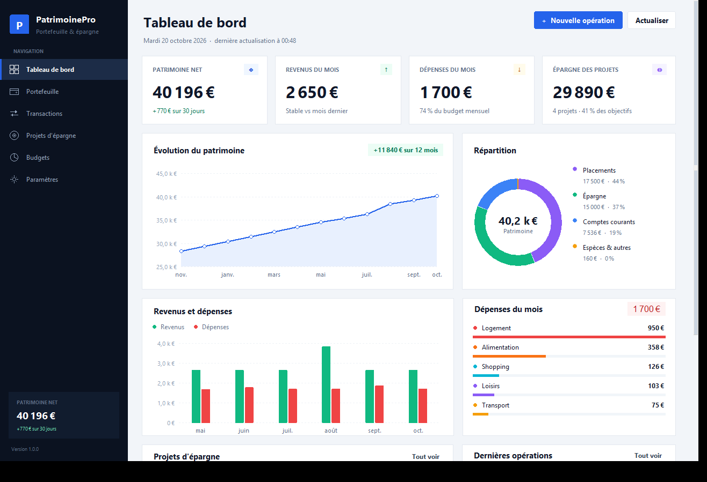
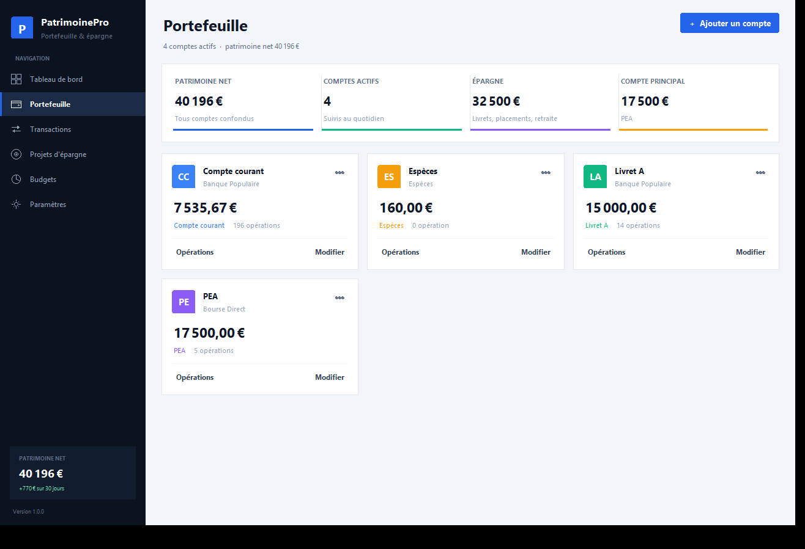
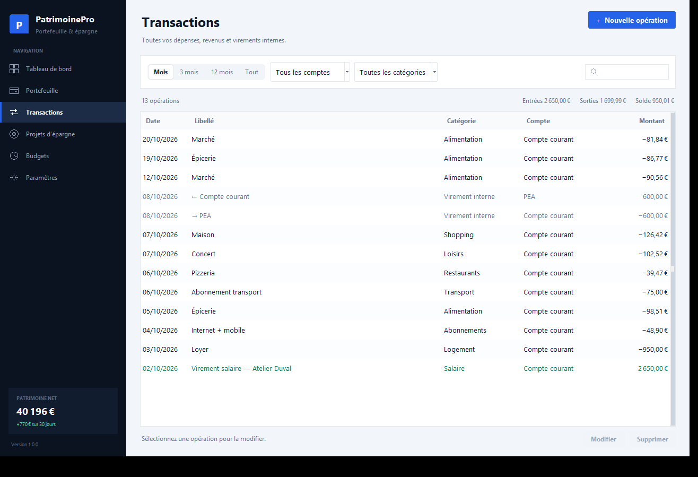
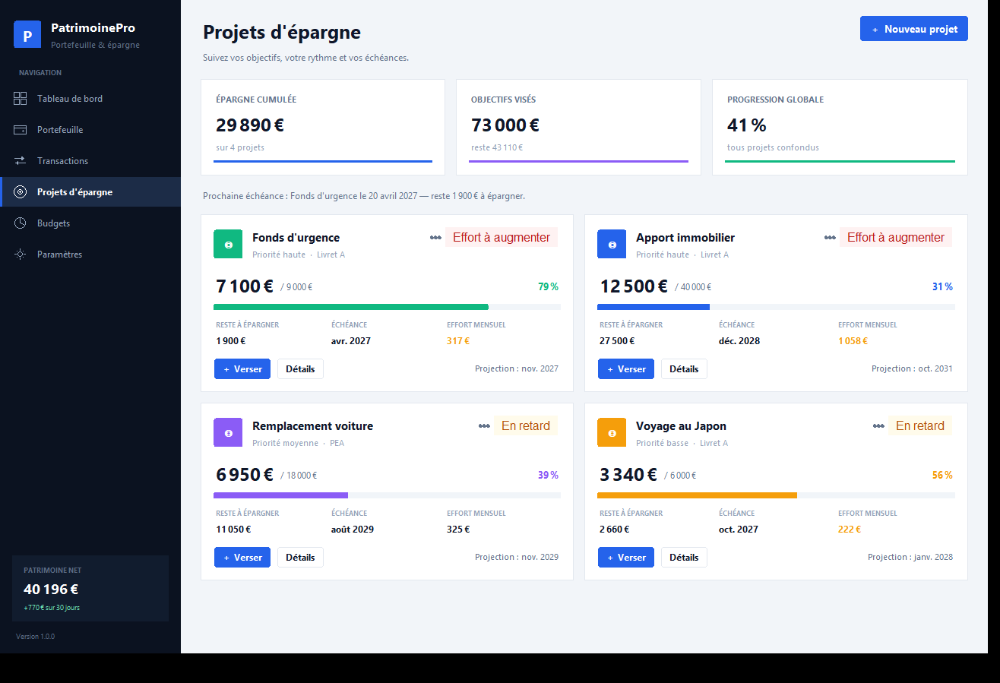
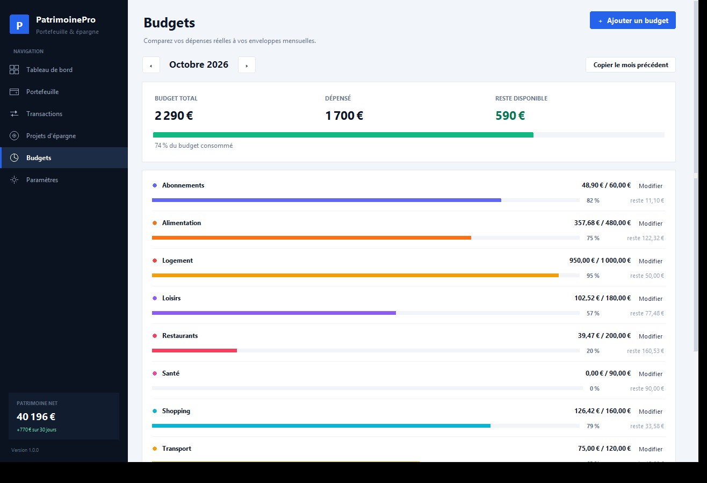
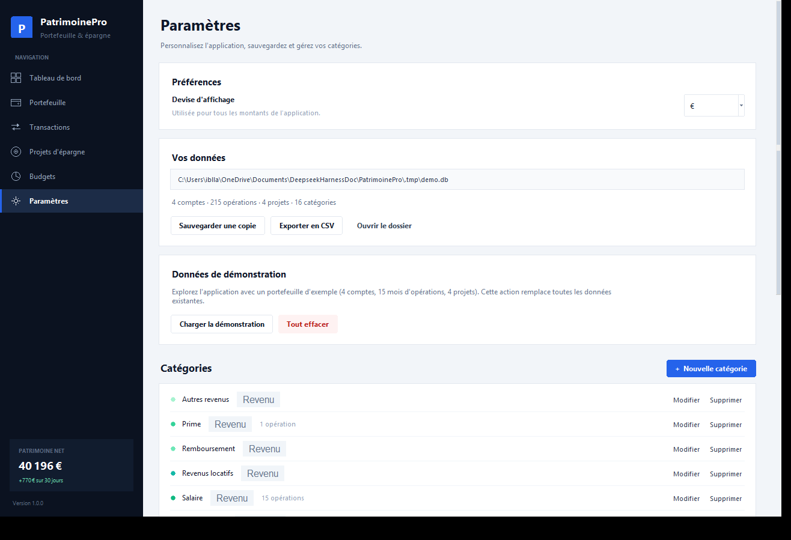
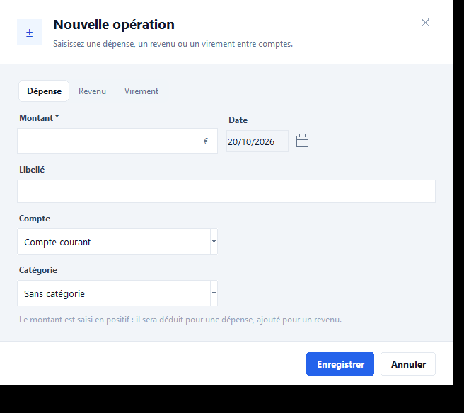
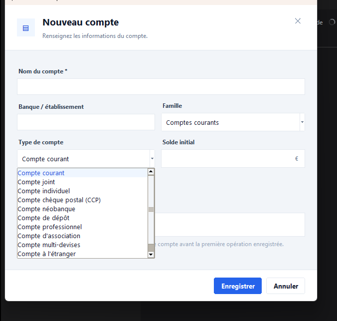
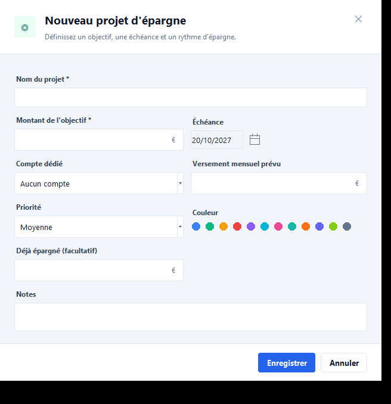

# PatrimoinePro

**Gestion de portefeuille personnel et de projets d'épargne** — application de bureau
Windows, 100 % hors ligne, avec base de données locale.




> **English** — PatrimoinePro is a free, offline personal-finance desktop app for Windows
> (Python + Tkinter + SQLite). It manages accounts, transactions, savings goals, budgets and
> charts. No account, no cloud, no telemetry; the interface is in French.
> **Download:** see [Releases](../../releases) → unzip → run `PatrimoinePro.exe`.

---

## Sommaire

- [Fonctionnalités](#fonctionnalités)
- [Captures](#captures)
- [Installation](#installation)
- [Premier lancement](#premier-lancement)
- [Vos données](#vos-données)
- [Raccourcis](#raccourcis-clavier)
- [Technique](#technique)
- [Contribuer](#contribuer)
- [Licence](#licence)

---

## Fonctionnalités

### Portefeuille
- **37 types de comptes** rangés en 5 familles :
  - **Comptes courants** (11) : compte courant, joint, individuel, CCP, néobanque, dépôt,
    professionnel, association, multi-devises, à l'étranger, prépayé.
  - **Épargne** (10) : Livret A, LDDS, LEP, livret jeune, livret bancaire, CEL, PEL,
    compte à terme, épargne générique, épargne salariale (PEE).
  - **Placements** (9) : PEA, PEA-PME, CTO, assurance-vie, SCPI, crowdfunding, crypto, or.
  - **Retraite** (4) : PER, PERP, PER entreprise (art. 83), PER Madelin.
  - **Espèces & autres** (3) : espèces, caisse, autre.
- Solde initial, banque, couleur, notes ; comptes **archivables** sans perdre l'historique.
- Dépenses, revenus et **virements internes** (deux écritures liées, patrimoine inchangé).
- Catégories personnalisables, recherche instantanée, filtres par période, compte et catégorie.
- Vue consolidée du **patrimoine net**, répartition par famille de comptes, évolution sur 12 mois.

### Projets d'épargne
- Objectif chiffré, échéance, compte dédié, versement mensuel prévu, priorité, couleur.
- **Progression**, reste à épargner, **effort mensuel nécessaire** pour tenir l'échéance.
- **Projection** de la date d'atteinte d'après votre rythme réel de versements.
- Statut automatique : objectif atteint, en avance, dans les temps, en retard,
  effort à augmenter.
- Historique des versements et courbe cumulée avec ligne d'objectif.
- Un versement peut créer automatiquement le **virement bancaire** vers le compte dédié.

### Budgets
- Enveloppes mensuelles par catégorie, navigation mois par mois.
- Dépensé / budget / reste, alertes de dépassement, copie des budgets du mois précédent.
- Mise en évidence des **catégories sans budget** et de leurs dépenses.

### Données
- Base **SQLite** locale, sauvegarde en un clic, export **CSV** (compatible Excel français).
- Devise paramétrable (€, $, £, CHF, MAD, DZD, TND, CAD).
- Gestion complète des catégories, jeu de démonstration, remise à zéro.

---

## Captures

| Écran | Aperçu |
|---|---|
| Tableau de bord |  |
| Portefeuille |  |
| Transactions |  |
| Projets d'épargne |  |
| Budgets |  |
| Paramètres |  |

| Saisie | Aperçu |
|---|---|
| Nouvelle opération |  |
| Nouveau compte (familles et types) |  |
| Nouveau projet d'épargne |  |

---

## Installation

### Option 1 — Télécharger l'application (recommandé)

1. Ouvrir la page **[Releases](../../releases)** du dépôt.
2. Télécharger `PatrimoinePro-windows.zip` (dernière version).
3. Décompresser l'archive **où vous voulez**.
4. Lancer `PatrimoinePro.exe`. Le dossier `_internal` doit rester à côté de l'exécutable.

> L'exécutable n'est pas signé numériquement. Au premier lancement, Windows peut afficher
> *« Windows a protégé votre ordinateur »* : cliquez sur **Informations complémentaires**
> puis **Exécuter quand même**. Le code source complet est dans ce dépôt.

### Option 2 — Installer dans votre profil

`Installer PatrimoinePro.bat` copie l'application dans
`%LOCALAPPDATA%\Programs\PatrimoinePro` et crée un raccourci **PatrimoinePro** sur le
Bureau. Recommandé si le dossier de l'application est synchronisé (OneDrive, Dropbox…).

### Option 3 — Depuis les sources

Prérequis : **Python 3.11 ou plus** avec Tkinter (installateur officiel python.org).

```powershell
git clone https://github.com/<votre-compte>/PatrimoinePro.git
cd PatrimoinePro
python PatrimoinePro.pyw
```

ou double-cliquez sur `Lancer avec Python.bat`.

Aucune dépendance à installer : l'application n'utilise que la bibliothèque standard.

---

## Premier lancement

L'application propose de **charger un portefeuille de démonstration** (4 comptes, 15 mois
d'opérations, 4 projets, budgets) ou de partir d'une base vide.

**Guide en 4 étapes**

1. **Portefeuille → Ajouter un compte** : nom, famille, type, solde actuel.
2. **Transactions → Nouvelle opération** : dépense, revenu ou virement.
3. **Projets d'épargne → Nouveau projet** : objectif, échéance, versement mensuel.
   Puis **Verser** à chaque mise de côté (le virement est créé si un compte dédié est choisi).
4. **Budgets → Ajouter un budget** : plafonds mensuels par catégorie.

---

## Vos données

Par défaut : `%APPDATA%\PatrimoinePro\patrimoine.db`

- **Paramètres → Sauvegarder une copie** enregistre un fichier `.db` où vous voulez.
- **Paramètres → Ouvrir le dossier** affiche l'emplacement dans l'explorateur.
- Pour utiliser un autre emplacement (clé USB, dossier synchronisé), définissez la variable
  d'environnement `PATRIMOINE_DB` avec le chemin complet du fichier `.db`.

Le fichier `.db` est autonome : copiez-le pour sauvegarder ou déplacer vos données.
L'application ne contacte aucun serveur et n'envoie aucune donnée.

---

## Raccourcis clavier

| Raccourci | Action |
|---|---|
| `Ctrl + N` | Nouvelle opération |
| `Ctrl + 1 … 6` | Navigation entre les écrans |
| `F5` | Actualiser l'écran courant |
| `Échap` | Fermer une fenêtre de saisie |
| `Entrée` | Valider une fenêtre de saisie |

---

## Technique

- **Python 3.11+** + **Tkinter/ttk**, **SQLite** (bibliothèque standard uniquement).
- Interface dessinée sur mesure : boutons arrondis, graphiques Canvas (courbes, donut, barres),
  calendrier, notifications, typographie Segoe UI, gestion du DPI.
- Exécutable généré avec **PyInstaller** en mode dossier (pas d'auto-extraction dans `%TEMP%`).

### Structure

```
PatrimoinePro/
├─ PatrimoinePro.pyw          point d'entrée
├─ app/
│  ├─ main.py                 fenêtre principale, navigation, actions
│  ├─ db.py                   schéma SQLite, requêtes, catalogue des comptes, démo
│  ├─ analytics.py            patrimoine, flux, budgets, trajectoires de projets
│  ├─ dialogs.py              formulaires (compte, opération, projet, versement…)
│  ├─ widgets.py              composants graphiques sur mesure
│  ├─ theme.py                palette, typographie, styles ttk
│  ├─ utils.py                dates et montants français
│  └─ views/                  tableau de bord, portefeuille, transactions,
│                             projets, budgets, paramètres
├─ assets/                    icônes
├─ docs/screenshots/          captures utilisées par ce README
├─ tests/                     tests métier, formulaires et interface
├─ tools/                     génération d'icône, captures, script de build
├─ build_exe.ps1              compilation locale de l'exécutable
└─ .github/workflows/build.yml  compilation automatique par GitHub Actions
```

### Tests

```powershell
python tests/test_backend.py    # calculs, base de données, formats
python tests/test_dialogs.py    # formulaires et validation
python tests/test_ui.py         # construction de tous les écrans
```

### Compiler soi-même

```powershell
python -m pip install pyinstaller
powershell -ExecutionPolicy Bypass -File build_exe.ps1
```

L'exécutable est produit à la racine (`PatrimoinePro.exe` + `_internal/`).

### Publier une version

Le workflow `.github/workflows/build.yml` compile et teste l'application sur Windows à
chaque étiquette `v*`, puis attache `PatrimoinePro-windows.zip` à la Release GitHub.

```powershell
git tag v1.1.0
git push origin v1.1.0
```

Le workflow peut aussi être lancé manuellement (onglet **Actions** → *Build Windows
executable* → *Run workflow*).

---

## Contribuer

Les issues et pull requests sont bienvenues.

- Merci de garder l'application **sans dépendance externe** (bibliothèque standard).
- Lancer les tests avant de proposer une modification.
- Une capture d'écran est appréciée pour tout changement visuel.

---

## Licence

[MIT](LICENSE) — utilisation, modification et redistribution libres, avec conservation de
la mention de copyright.

## Avertissement

PatrimoinePro est un outil de suivi personnel. Il ne fournit **aucun conseil financier,
fiscal ou juridique** et n'est pas affilié à un établissement bancaire. Vérifiez toujours
vos soldes auprès de vos banques. Sauvegardez régulièrement votre fichier `.db`.
